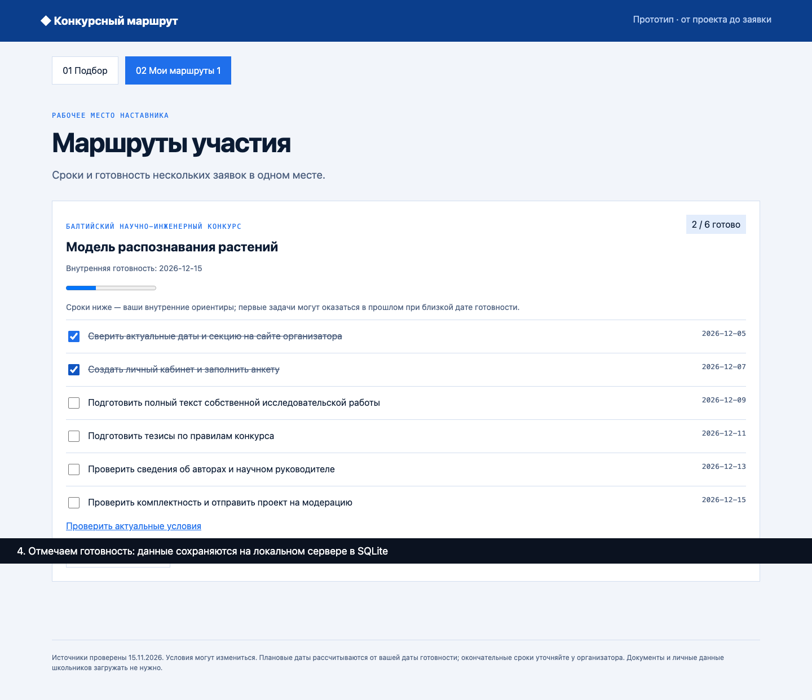

# Конкурсный маршрут

Локальный прототип помощника преподавателя: сопоставляет профиль ученика и проекта с условиями конкурсов, объясняет подбор и превращает выбранное мероприятие в сохраняемый план заявки.

Проверяем одну гипотезу: **наставнику полезно получить объяснимый подбор и готовый план действий, а затем отслеживать готовность нескольких заявок в одном месте**. Прототип проверяет техническую работоспособность сценария. Спрос, экономия времени и готовность школ платить пока не подтверждены.

## Запуск

Нужен Python 3.10 или новее. Сторонние пакеты, аккаунты и API-ключи не требуются.

```sh
python3 app.py
```

Откройте http://127.0.0.1:8088. Если порт занят:

```sh
python3 app.py --port 8090
```

Остановка — Ctrl+C. Приложение слушает только локальный интерфейс. Это однопользовательский учебный прототип, не готовый многопользовательский сервис для открытого размещения.

## Рабочий сценарий

1. Оставьте пример проекта: 9 класс, 15 лет, два автора, искусственный интеллект, собственная работа готова.
2. Нажмите «Подобрать конкурсы». Посмотрите основания подбора и ограничения НТО Junior.
3. В карточке Балтийского конкурса откройте первоисточник и нажмите «Создать маршрут».
4. Отметьте несколько действий, обновите страницу и откройте «Мои маршруты»: статусы сохраняются.
5. Скачайте маршрут в JSON. Измените размер команды на 4 и повторите подбор: Балтийский конкурс будет исключён по сохранённому ограничению.

Для демонстрации контрпримера: 6 класс, 12 лет — старший трек НТО исключается, Junior доступен для дальнейшей проверки.

## Что действительно работает

- Проверка класса, возраста, размера команды, направления и наличия исследовательской работы.
- Объяснение ограничений без выдуманной вероятности победы.
- Генерация плана из подготовленной редактором карты требований.
- Сохранение нескольких маршрутов и статусов в SQLite, экспорт JSON.
- Два связанных экрана: подбор и маршруты наставника.

Это **не LLM-агент**: правила выполняются локально и детерминированно. ИИ-агент использовался при разработке кода. Отдельное необязательное задание n8n не является частью этого продукта.

## Данные и ограничения

Три карточки небольшого проверочного каталога подготовлены по открытым страницам организаторов, просмотренным 15.11.2026:

- [Балтийский конкурс: условия](https://baltkonkurs.ru/participant/participant-requirement/).
- [НТО: треки и формат](https://ntcontest.ru/).
- [НТО Junior](https://junior.ntcontest.ru/).

Возраст и размер команды Балтийского конкурса проверяются по указанной странице. Минимальные классы в этой карточке — ограничение школьного сегмента прототипа, **не отдельное требование организатора**. Тематические метки — редакционная классификация для поиска, а не гарантия соответствия секции. НТО принимает также другие категории, но приложение ограничено 5–11 классами.

На странице Балтийского конкурса обнаружено противоречие в годе одной из волн подачи. Поэтому официальный дедлайн не подставляется. Пользователь задаёт **внутреннюю дату готовности**, от которой планируются действия с двухдневным интервалом. Этот интервал — механизм планирования прототипа, не регламент конкурса; даты можно использовать как ориентир, а сроки организатора проверять отдельно. При близкой дате первые действия могут оказаться в прошлом — это явно показано в интерфейсе.

План составляется из редакторской карты требований, а не автоматически извлекается из произвольного PDF. Соответствие всем положениям, окончательный допуск и качество исследования проверяет человек. Прототип не отправляет заявку организатору и не рассылает напоминания. Личные данные учеников и документы вводить не нужно; имя проекта может быть условным.

## Устройство

- `app.py` — HTTP-сервер стандартной библиотеки Python, правила сопоставления и SQLite.
- `catalog.json` — условия, источники и шаблоны действий.
- `static/` — HTML/CSS/JavaScript без сборки и фреймворков.
- `data/routes.db` — локальные данные, создаются при запуске и исключены из Git.
- `tests/test_app.py` — граничные условия, сохранение и отказ от некорректных изменений.

Существующий авторский [YAK Calendar](https://calendar.yakunin.tech/) служит основой предметной модели «событие — условия — этапы». Здесь выделен новый проверяемый сценарий; код исходного календаря и рабочие базы не копируются.

## Проверки

```sh
python3 -m unittest discover -s tests -v
```

Проверка интерфейса и видео записываются отдельно с настоящим локальным сервером. Веб-страница не использует небезопасную подстановку пользовательского текста через innerHTML. SQL параметризован, размер запроса ограничен, запросы с чужим Origin отклоняются. Для публикации в интернете потребуются авторизация, HTTPS и дополнительные ограничения нагрузки.

## Учебный проект

Автор — Дмитрий Якунин. Индивидуальный формат. Коммерческая модель — гипотеза годовой подписки школы после пилота. Интервью, продажи и результаты внедрения не заявлены. Публичный репозиторий должен содержать только исходники: базы, логи, записи браузера и секреты исключены через `.gitignore`.


## Демонстрация

[Видео реального локального сценария, 39 секунд](docs/demo.mp4)



Проверено при подготовке: пять автоматических тестов; браузерный сценарий подбора, создания маршрута, смены статусов, сохранения после обновления и ограничения команды; мобильная ширина без горизонтального переполнения. Это техническая проверка, не пользовательский пилот.
